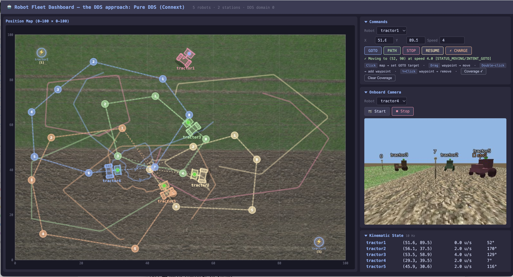

# Tractor Fleet: RTI Connext DDS Blueprint

An autonomous tractor fleet simulation built with
[RTI Connext DDS](https://www.rti.com/products/connext-professional). It shows
how DDS publish-subscribe, DDS request-reply, partitions, durability,
liveliness, and discovery solve a distributed-systems problem end to end.
Tractors, charging stations, and the fleet dashboard each run as independent
applications that share one data space. None of them opens a connection to
another or knows where another runs.

## Scenario

A fleet of autonomous tractors works a field while coordinating with charging
stations and a fleet management dashboard.



Each tractor follows its own route, avoids its neighbors, and goes to charge
when its battery runs low. Stations queue tractors for their single dock, and
an operator watches the fleet, sends commands, and views any tractor's
onboard camera.

### Components

| Component | Role | Instances |
|---|---|---|
| **Tractor** | Route following, collision avoidance, state and telemetry publishing, coverage trail, onboard video, command service, charging client | 1 per tractor (default 5) |
| **Charging Station** | Single dock with a FIFO queue; publishes its status, serves slot reservation and release, and frees the slot of a tractor that disappears | 1 per station (default 2) |
| **Fleet UI** | Web dashboard: live map, tables, commands, and video | 1 (default) |
| **RTI Persistence Service** | Stores coverage trails so they survive tractor restarts | Optional |

Defaults can be changed in `shared/fleet_common.sh`.

### Data Flows

| Data Flow | Send Policy | Reliability | Notes |
|-----------|------------|-------------|-------|
| `KinematicState` | Periodic (10 Hz) or on significant change | Best-effort | Consumers must know position within 1 m, velocity within 1 m/s |
| `OperationalState` | On change | Reliable | Latest state must be known by all |
| `Intent` | On change | Reliable | Latest intent must be known by all |
| `Telemetry` | Periodic | Best-effort | CPU, memory, motor temperature, and link quality; loss is tolerable |
| `LiveVideo` | Streaming | Best-effort | On demand from the fleet UI |
| `StationStatus` | On change | Reliable | Dock position, occupancy, and queue of each station |
| `CoveragePoint` | On move | Reliable | Trail history; survives tractor restarts with Persistence Service |
| Commands, charging slots | Request-reply | Reliable | Must be delivered |

### Interaction Patterns

- **Publish/Subscribe:** kinematic and operational state, intent, telemetry,
  video, station status, coverage
- **Request/Reply:** operator commands to tractors; charging-slot reservation
  and release
- **Discovery and liveliness:** tractors and stations find each other and
  learn when one leaves

### System-Level Design Drivers

- **Dynamic discovery:** participants come and go at runtime; IP addresses
  change
- **Late-joiner convergence:** new participants need current state
  immediately
- **Presence detection:** detect when a participant appears or disappears,
  without application heartbeats, within a bound chosen per deployment (30 s
  in this demo)
- **Mixed connectivity:** WiFi, 5G, and radio links with temporary disconnects
- **Per-flow QoS:** not all data flows are equally critical
- **Scale:** must work for 5 tractors and for 100+

## Why Connext DDS for Autonomous Fleets

Writing a demo like this is straightforward, especially with AI assistance.
What matters is how the **running system** behaves as the fleet grows, when
links drop, and when tractors restart. The examples below come straight from
the code in this repo.

### Example 1: Sharing position (pub/sub)

Every tractor needs every other tractor's position to avoid collisions, and
the dashboard needs all of them for its map.

A tractor calls `write()` once, ten times a second, on the `KinematicState`
topic, and the middleware delivers each sample to every matched reader. The
tractor doesn't know how many peers or dashboards exist or where they run.
Each process has one `KinematicState` reader, keyed by `tractor_id`, whether
the fleet has 5 tractors or 100. When a sixth tractor starts, the others
receive its position without any configuration change.

### Example 2: Charging (shared state plus request-reply)

A tractor with a low battery must pick a station, reserve a place in its
queue, and follow the queue until the dock is free.

Each station publishes `StationStatus` (dock position, occupancy, queue) with
transient-local durability, so every tractor already has the current status
of every station. The tractor picks the shortest queue locally and sends one
`SlotReserve` request naming that station. From then on it follows its queue
position through the station's published status: when it reaches the front,
it drives to the dock. No polling, no confirmation round trips, and a
dashboard started later sees the same queues immediately.

### Example 3: Video on demand (partitions)

Rendering and streaming video from every tractor all the time would waste CPU
and bandwidth; the operator watches one at a time.

Each tractor writes `LiveVideo` in a partition named after itself. The
dashboard's video reader starts in a partition no tractor uses. When the
operator selects a tractor, the dashboard changes its partition to that
tractor's ID, and DDS matches exactly that writer. Each tractor renders only
while its writer has a matched reader. Starting and stopping video needs no
application protocol: it's a QoS change on the dashboard.

### Example 4: Commanding one tractor or the whole fleet (request-reply)

The operator sometimes needs one tractor to go somewhere, and sometimes needs
every tractor to stop at once.

Every tractor's command service shares one service name, and the request's
`tractor_id` says which tractor should act: one tractor's ID, or `ALL`. Each
tractor reads requests through a content filter
(`tractor_id = '<its own ID>' OR tractor_id = 'ALL'`) that Connext evaluates
at the writer, so a command for `tractor3` is sent to tractor 3 only. The
other tractors never receive it and don't spend time rejecting it.

A request for `ALL` passes every tractor's filter: the dashboard's fleet-wide
STOP is one `write()`, every tractor receives it at essentially the same
moment, and each tractor's reply comes back correlated to that one request.
The dashboard needs no list of addresses and no connection per tractor, and
tractors that joined a minute ago are included automatically. With
traditional RPC, the client would have to find every server, connect to
each, and fan the call out itself.

### At fleet scale

Take 100 tractors publishing `KinematicState` at 10 Hz, each consumed by every
other tractor and the dashboard:

| | Connext DDS |
|---|---|
| **Application `write()` calls** | 100 × 10 = **1,000/s**: one `write()` per tractor per update, however many readers there are |
| **Network packets (LAN multicast)** | The `KinematicState` readers share a multicast address in `fleet_qos.xml`, so each sample is sent once: about **1,000/s**, compared with about 100,000 messages/s if every tractor sent to every reader point to point |
| **Readers per process** | **1** `KinematicState` reader, whether there are 5 tractors or 100 |
| **Adding a dashboard or monitor** | The `write()` count stays the same; the new reader joins the multicast group |

### When connectivity is temporarily lost

**Scenario:** a tractor's WiFi or 5G link drops for a few seconds.

- **State and intent:** the writer keeps unacknowledged samples, and the
  reliability protocol resends them when the link returns. With keep-last
  history, peers converge on the latest value rather than replaying every
  change.
- **Position:** best-effort samples sent during the outage are lost by
  design; the next one arrives within 100 ms of reconnection.
- **Address changes:** DDS identifies participants independently of their
  network address. After roaming to a new address, or a full disconnect and
  reconnect, discovery re-announces the tractor and peers match it again
  automatically.
- **Longer outages:** if the link stays down past the 30 s liveliness lease,
  peers are notified that the tractor is gone, and when it returns they
  rediscover it and receive its current state.

### When a tractor fails or restarts

- **Detection without heartbeats:** if a tractor stops sending position
  updates, the `KinematicState` deadline (500 ms) fires and the dashboard
  marks it "no updates" within about a second. When its writers go away,
  peers learn of it through DDS: at once for an orderly shutdown, or when the
  30 s liveliness lease expires after a crash. The dashboard then shows it
  offline and removes it shortly after.
- **The fleet adapts:** other tractors stop steering around the departed
  tractor's last position, and if it held a charging slot, the station frees
  the slot and promotes the next tractor in the queue. No application
  heartbeat or timeout code is involved.
- **Recovery:** a restarted tractor is discovered automatically and receives
  every peer's current state and every station's queue from their
  transient-local caches. With Persistence Service running, the dashboard also
  gets back the trail the tractor drew before it restarted.

### Adding a new component

**Scenario:** add a safety monitor that alerts when two tractors come too
close.

- **Data access:** one reader on `KinematicState`, the same topic the
  tractors already publish.
- **Discovery:** join the domain with the fleet's domain tag; every tractor is
  discovered automatically.
- **Impact on the existing system:** none. Existing applications don't know
  the monitor exists. A recorder or a cloud gateway would join the same way.

### Real-time guarantees as configuration

Connext enforces these QoS policies in the middleware. They behave the same
in any language, and changing them means editing
[`fleet_qos.xml`](fleet_qos.xml), not code:

| Requirement | Connext DDS mechanism |
|---|---|
| **"Tell me when a tractor disappears"** | Automatic liveliness with a 30 s lease on the state topics; readers see the tractor's instances become not alive, and the dashboard, peers, and stations react |
| **"Alert me if position updates stop"** | Deadline QoS on `KinematicState` (200 ms writer / 500 ms reader); the dashboard marks the tractor "no updates" |
| **"New participants see current state immediately"** | Transient-local durability on `OperationalState`, `Intent`, and `StationStatus` |
| **"Keep each tractor's coverage trail"** | Persistent durability with keep-last 1000 per tractor; Persistence Service stores it across restarts |
| **"Send video only when someone watches"** | One partition per tractor; the writer renders only while matched |
| **"Commands must arrive"** | Reliable, keep-all request-reply profiles |
| **"Stop the whole fleet at once"** | One request addressed to `ALL`; every tractor's replier receives it, and the replies correlate to it |
| **"Send a command only to the tractor it's for"** | A content filter on each tractor's request topic, evaluated at the writer |
| **"Video must not delay state updates"** | Separate topics with their own QoS, so best-effort video never blocks reliable state |

## Prerequisites

- Python 3.14.3+
- A free Connext license file (`rti_license.dat`). Download it from
  [evaluation.rti.com/workspaces/license](https://evaluation.rti.com/workspaces/license)
  after logging in with your RTI account. If you don't have an account, you
  can create one on the same page; it's also free.

The demo does not need a Connext installation: the setup script installs
the Connext Python API (`rti.connext`) from PyPI, and the generated type
support is checked in. See
[Optional: Full Connext Installation](#optional-full-connext-installation)
to change the data types or keep coverage across tractor restarts.

## Quick Start

The setup script creates a virtual environment and installs dependencies.
It uses `python3` by default — if that does not point to Python 3.14.3+,
set the `PYTHON` variable:

```bash
# Clone the repository
git clone https://github.com/rticommunity/rticonnextdds-blueprint-tractor-fleet.git
cd rticonnextdds-blueprint-tractor-fleet

# If your default python3 is 3.14.3+:
source setup.sourceme

# If python3 points to an older version, specify the interpreter:
PYTHON=python3.14 source setup.sourceme

# Point the demo at your license file
export RTI_LICENSE_FILE=/path/to/rti_license.dat

# Run the demo: stations, tractors, and the dashboard
scripts/demo_start.sh
```

Open http://localhost:5000 for the dashboard. Stop everything with
`scripts/demo_stop.sh`.

All applications join DDS domain `0` with the domain tag
`tractor-fleet-salinas-CA`, which keeps them isolated from other Connext
applications on the network. To run a second, independent fleet on the same
network, set a different `DOMAIN_TAG` (or `DOMAIN_ID`) in the environment.

You can also start components separately:

```bash
scripts/demo_start.sh stations           # all charging stations
scripts/demo_start.sh tractors           # all tractors
scripts/demo_start.sh ui                 # dashboard only
scripts/demo_start.sh tractor tractor1   # single tractor
scripts/demo_start.sh station station1   # single station
```

`scripts/demo_stop.sh` takes the same component names (`tractors`,
`stations`, `ui`, `persistence`, `tractor <name>`, `station <name>`). It sends
SIGTERM, waits for each application to close its DDS entities, and
force-kills anything still running after `GRACE_SECONDS` (default 10).

To check that everything works end to end, run the smoke test (about 40 s).
It starts the whole demo on a private domain tag with temporary persistence
storage, exercises discovery, commands, charging, coverage, and video through
the dashboard, stops one tractor that holds a charging slot to check that the
dashboard, the station, and its peers notice, stops the demo, and prints
PASS/FAIL for each check (SKIP for Persistence Service when it isn't
running):

```bash
scripts/smoke_test.sh
```

### Optional: Full Connext Installation

Install RTI Connext DDS 7.7 by following the instructions at
[evaluation.rti.com](https://evaluation.rti.com) to get two more tools:

- **`rtiddsgen`**, to regenerate the Python type support after changing
  `fleet_types.idl`:

  ```bash
  python/types_generate.sh
  ```

- **RTI Persistence Service**, which stores the tractors' coverage trails
  so they survive tractor restarts. Without it, each tractor still delivers
  its recent trail to late-joining dashboards, but a restarted tractor starts
  a new one.

`setup.sourceme` finds Connext 7.7.0 in `/Applications`, `/opt`, or your home
directory and sets `NDDSHOME`; otherwise, export `NDDSHOME` before sourcing
it. With `NDDSHOME` set, the license defaults to `$NDDSHOME/rti_license.dat`.

`scripts/demo_start.sh` starts Persistence Service whenever it finds it.
Set `DEMO_RUN_PERSISTENCE_SERVICE` to choose:

| Value | Behavior |
|-------|----------|
| `AUTO` (default) | Start it if the Connext installation provides it |
| `FORCED_ON` | Always start it; stop with an error if it isn't installed |
| `FORCED_OFF` | Never start it |

See the [Connext DDS design](docs/DESIGN.md) for the architecture and the
[component specifications](python/spec/) for each application.

## Repository Structure

```
├── README.md                # This file
├── fleet_types.idl          # IDL type definitions (single source of truth)
├── fleet_qos.xml            # QoS profiles
├── fleet_persistence.xml    # RTI Persistence Service configuration
├── setup.sourceme           # Environment setup (source, not execute)
├── python/                  # Python apps, requirements, type generation
│   └── spec/                # Per-component specifications
├── scripts/                 # Demo launch, stop, and smoke-test scripts
├── shared/                  # Fleet configuration and arena assets
└── docs/
    ├── DESIGN.md            # Connext DDS architecture deep dive
    └── design_process/      # How we built this (AI-assisted design journey)
```

## Connext DDS Features Used

| Connext DDS capability | What it does in this system |
|---|---|
| **Data-centric pub/sub** | Each tractor writes its state once; every peer tractor and dashboard receives it |
| **Request-reply** | Operator commands (to one tractor or, in one request, to all) and charging-slot reservations use DDS RPC over the same data space |
| **Content filtering** | Each tractor receives only the commands addressed to it or to `ALL`, filtered at the writer |
| **Partitions** | The dashboard selects one tractor's video; only that tractor renders and sends frames |
| **Durability (transient-local and persistent)** | Late-joining tractors and dashboards get current state, intent, station queues, and coverage trails immediately |
| **Liveliness and deadline** | The dashboard, peers, and stations learn when a tractor goes silent or disappears, without application heartbeats |
| **Declarative QoS** | Reliability, durability, history, deadline, and liveliness are set in one XML file, not in application code |
| **Domain tag** | Separates this fleet from other Connext applications on the network |

## How We Built This

This project was designed iteratively with an AI coding assistant, together
with [RTI's Connext AI Design Expert (Connext MCP server)](https://chatbot.rti.com/docs/getting-started).
The [`docs/design_process/`](docs/design_process/) directory records that
process: the original scenario and the key prompts and decisions behind the
components, interfaces, data model, QoS, and algorithms.

## Related Blueprints

- [Air Traffic Control](https://github.com/rticommunity/rticonnextdds-blueprint-air-traffic)
  — a mixed C++/Python air-traffic scenario built with RTI Connext DDS.
